# Loan Portfolio & Customer Behaviour Analysis
### Institutional Credit Risk Analytics, Streamlit Web App & Power BI Intelligence
**Repository:** [maddy1811/loan-portfolio-customer-behaviour-analysis](https://github.com/maddy1811/loan-portfolio-customer-behaviour-analysis)  
**Author / Analyst:** [maddy1811](https://github.com/maddy1811)  
**Target Program:** Nasdaq 2027 Campus Program Application (Financial Technology & Analytics)  
**Technology Stack:** Python 3.13, Streamlit, Plotly, Pandas, NumPy, Matplotlib, Seaborn, Power BI, DAX, Pytest, Jupyter

---

## 1. Executive Summary & Project Overview

This repository houses an end-to-end financial risk analysis, interactive Streamlit web application, and Power BI business intelligence solution evaluating **39,717 consumer loans** ($434.81M in funded capital) from the LendingClub loan portfolio.

The project translates raw credit origination data into institutional credit risk metrics (Debt-to-Income, Loan-to-Income, Monotonic Default Curves, Net Credit Loss, Recovery Efficiency), and deploys a 5-page interactive Streamlit dashboard accompanied by complete 3-page Power BI dashboard specifications.

```
loan-portfolio-customer-behaviour-analysis/
├── app.py                                                <- Interactive Streamlit Web Application (5 Pages)
├── .streamlit/
│   └── config.toml                                       <- Fintech Theme & Server Configuration
├── data/
│   ├── raw/
│   │   ├── loan.csv                                      <- Original raw CSV (preserved locally; git-ignored)
│   │   └── Data_Dictionary.xlsx                          <- Official LendingClub metadata dictionary
│   └── processed/
│       ├── loans_cleaned.csv                             <- Cleaned portfolio dataset (39,717 rows, 74 cols)
│       ├── loans_completed_for_default_analysis.csv      <- Completed loans cohort (38,577 rows)
│       └── data_quality_report.json                      <- Automated transformation & quality audit
├── figures/                                              <- 15 High-resolution (300 DPI) publication charts
│   ├── 01_loan_amount_distribution.png
│   ├── 02_loan_purpose_distribution.png
│   ├── 03_interest_rate_distribution.png
│   ├── 04_customer_income_segments.png
│   ├── 05_employment_tenure.png
│   ├── 06_home_ownership.png
│   ├── 07_credit_grades_subgrades.png
│   ├── 08_debt_to_income_ratio.png
│   ├── 09_default_rate_by_grade.png
│   ├── 10_default_rate_by_purpose.png
│   ├── 11_default_rate_by_employment_length.png
│   ├── 12_loan_issuance_trends.png
│   ├── 13_loan_performance_by_term.png
│   ├── 14_numeric_correlation_heatmap.png
│   └── 15_loss_recovery_waterfall.png
├── notebooks/
│   └── 01_loan_portfolio_eda_cleaning.ipynb             <- Executed end-to-end Jupyter Notebook with all outputs
├── power_bi/
│   ├── dax_measures.md                                  <- 20+ Production DAX formulas with mathematical descriptions
│   ├── dashboard_guide.md                               <- 3-page executive fintech dashboard blueprint
│   └── data_model_schema.md                             <- Single-Table & Star-Schema dimensional architectures
├── src/
│   ├── data_cleaning.py                                 <- Modular cleaning, date parsing & feature pipeline
│   ├── risk_metrics.py                                  <- Institutional credit risk & portfolio metrics engine
│   ├── generate_visualizations.py                       <- Automated chart generation script
│   └── inspect_dataset.py                               <- Dataset empirical profiler
├── tests/
│   └── test_portfolio_analysis.py                       <- 11 Automated Pytest validation checks (100% PASS)
├── utils/
│   └── dashboard_helpers.py                             <- Streamlit styling and Plotly chart configuration
├── requirements.txt                                     <- Reproducible Python environment specifications
└── .gitignore                                           <- Data security & environment exclusions
```

---

## 2. Core Financial Indicators & Portfolio Verification

| Financial & Risk Indicator | Value | Methodological & Banking Definition |
| :--- | :---: | :--- |
| **Total Loan Count** | **39,717** | Verified 100% unique primary keys (`id` and `member_id`; 0 duplicates). |
| **Total Funded Capital** | **$434,810,325.00** | Actual principal capital disbursed by LendingClub. |
| **Gross Requested Volume** | **$445,602,650.00** | Requested borrowing volume across applicants (Mean: $11,219.44). |
| **Fully Paid Loans** | **32,950** (82.96%) | Completed contractual repayment without loss. |
| **Charged Off Loans (Defaults)** | **5,627** (14.17%) | Written off as uncollectible debt. |
| **Active Ongoing Loans (`Current`)** | **1,140** (2.87%) | Open, actively amortizing exposure. Excluded from default denominator. |
| **Completed Loans Cohort** | **38,577** | $\text{Fully Paid} + \text{Charged Off} = 32,950 + 5,627$. |
| **Historical Default Rate** | **14.5864%** | $\frac{5,627}{38,577} = \mathbf{14.5864\%}$. (Banking standard excluding `Current` loans). |
| **Total Payments Collected** | **$482,704,393.92** | Principal returned ($388.96M) + Interest ($89.91M) + Recoveries ($3.78M). |
| **Gross Principal Shortfall** | **$43,813,064.69** | Unrepaid principal on defaulted loans prior to recovery collections. |
| **Post-Chargeoff Recoveries** | **$3,781,917.24** | Gross recovery collections post-default. |
| **Net Realized Credit Loss** | **$40,031,147.45** | Actual unrecovered principal capital post-recoveries. |
| **Portfolio Recovery Rate** | **8.63%** | $\frac{\$3,781,917.24}{\$43,813,064.69}$ recovery efficiency on defaulted principal. |
| **Net Investor Economic Return** | **+$47,894,068.92** | Total cash collections ($482.70M) minus funded capital ($434.81M). |

---

## 3. Interactive Streamlit Web Application

The interactive web dashboard (`app.py`) provides a responsive financial intelligence platform featuring:
* **Fintech Design System:** Crisp navy (`#1E3A8A`) and off-white theme, modular KPI cards, and customized Plotly charts.
* **Global Sidebar Slicers:** Interactive multi-select filtering across Credit Grade, Loan Purpose, Contract Term, Employment Tenure, Home Ownership, and Origination Years.
* **Dynamic Recomputation:** All KPI metrics, financial totals, and chart visuals update dynamically in response to slicer changes.
* **High Performance:** Ingests and processes data via `@st.cache_data`.

### Five Specialized Dashboard Views:
1. **Page 1 — Executive Overview:** High-level C-Suite KPI ribbon ($434.8M Funded, 39,717 Loans, 14.59% Default Rate, +$47.89M Return), outcome donut visual, monthly issuance trends, and funded capital by grade.
2. **Page 2 — Loan Portfolio Analysis:** Allocation by loan purpose ($234.3M Debt Consolidation), loan amount distribution, contractual APR box plots across grades, term structure, and income tier segmentation.
3. **Page 3 — Customer Behaviour:** Employment tenure breakdown, income vs. loan size scatter plot, DTI distribution with 20% risk benchmark line, and revolving credit utilization rates.
4. **Page 4 — Credit Risk Analysis:** Monotonic default rate curve (Grade A 5.99% to Grade G 33.78%), loan purpose default ranking (Small Business 27.08% vs Car/Major Purchase ~10%), and 36 vs 60-month term duration risk.
5. **Page 5 — Recovery & Loss Analysis:** Gross principal shortfall, recovery collections, net realized credit loss, loss severity, and financial recovery waterfall chart ($66.1M -> $22.3M -> $43.8M -> $3.8M -> $40.0M).

---

## 4. Key Credit Risk Insights

### Monotonic Risk-Based Pricing Gradient
Credit grades exhibit clear default probability separation:
* **Grade A (Prime):** 5.99% default rate (Average APR: 7.33%).
* **Grade B (Prime):** 12.21% default rate (Average APR: 11.01%).
* **Grade C (Near-Prime):** 17.19% default rate (Average APR: 13.53%).
* **Grade D (Near-Prime):** 21.99% default rate (Average APR: 15.66%).
* **Grade E (Subprime):** 26.85% default rate (Average APR: 17.63%).
* **Grade F (Subprime):** 32.68% default rate (Average APR: 19.64%).
* **Grade G (Subprime):** 33.78% default rate (Average APR: 21.31%).

### Contract Duration Risk (36 vs. 60 Months)
* **36-Month Loans:** 11.09% default rate.
* **60-Month Loans:** **25.31% default rate** (2.28× higher default risk). Longer amortizations severely amplify borrower default exposure over macroeconomic cycles.

### Loan Purpose Concentration & Loss Exposure
* **Small Business Loans:** **27.08% default rate** (highest across all borrowing categories).
* **Debt Consolidation & Credit Card:** Constitute **67.9% of funded capital** ($295.5M) with default rates of 15.33% and 10.78% respectively.
* **Major Purchase & Car Loans:** Safest categories with default rates around 10.3%–10.7%.

---

## 5. Visual Analytics Gallery

All 15 publication-grade figures are stored in `figures/`:

| Figure Reference | Chart Description | Core Financial Takeaway |
| :--- | :--- | :--- |
| 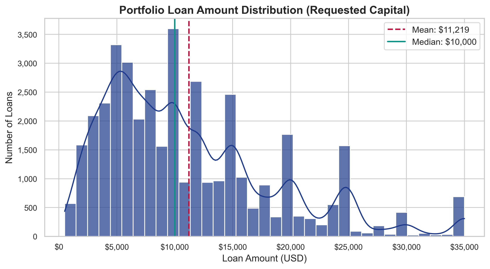 | **Loan Amount Distribution** | Mean loan size is $11,219; median is $10,000. Notable volume spikes at round underwriting limits ($5k, $10k, $15k, $20k, $25k). |
| 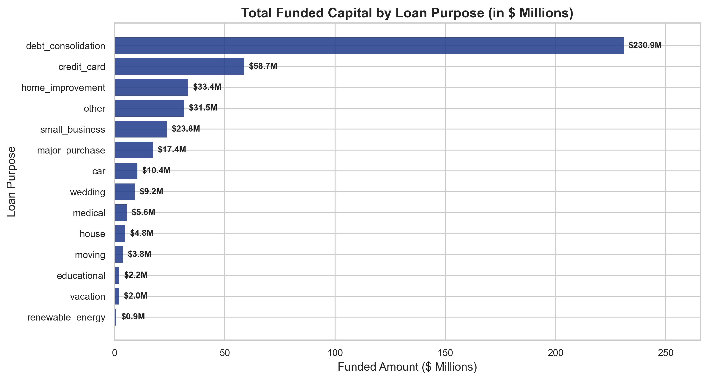 | **Funded Capital by Purpose** | Debt consolidation dominates ($234.3M), followed by credit card refinancing ($61.2M), together absorbing >67% of total deployed capital. |
| 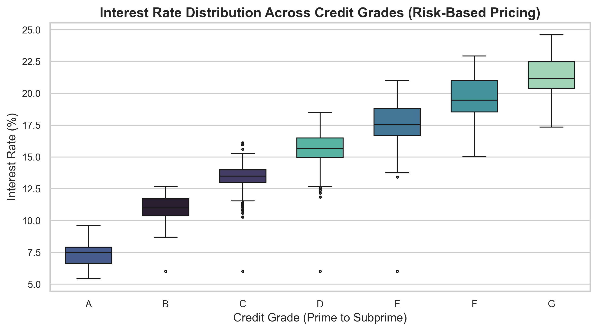 | **Interest Rate by Credit Grade** | Direct risk-based pricing: Grade A median APR is 7.49%, scaling monotonically to 21.49% for Grade G. |
| 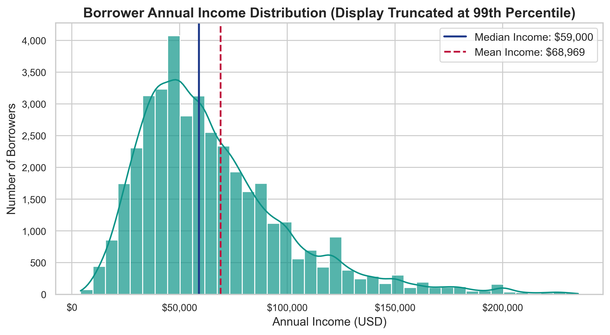 | **Borrower Income Segments** | Median income is $59,000 (mean $68,969). Over 65% of borrowers earn between $40,000 and $100,000 annually. |
| 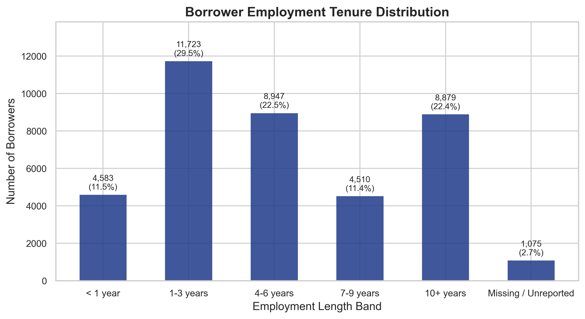 | **Employment Tenure** | Borrowers with 10+ years tenure represent the single largest borrower segment (22.3% of portfolio; 8,879 loans). |
| 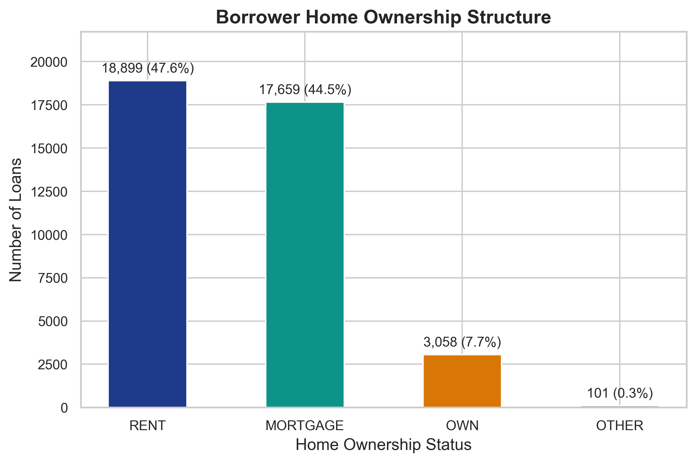 | **Home Ownership Profile** | Renters (47.6%) and Mortgage holders (44.5%) constitute 92.1% of all borrowers; outright home owners represent only 7.7%. |
| 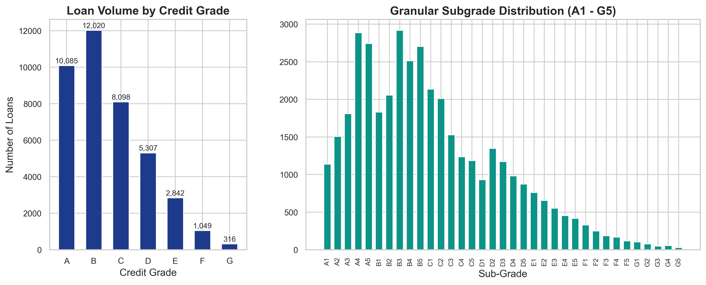 | **Grade & Subgrade Distribution** | Grade B (12,020 loans) and Grade A (10,085 loans) represent 55.7% of volume, confirming prime-heavy origination. |
| 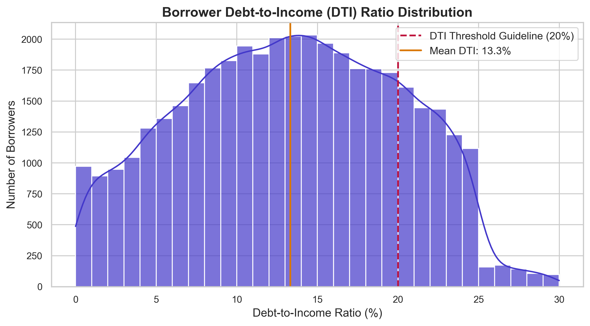 | **Debt-to-Income Distribution** | Mean DTI is 13.32%; 85.8% of borrowers maintain DTI below the conventional 20% risk threshold. |
| 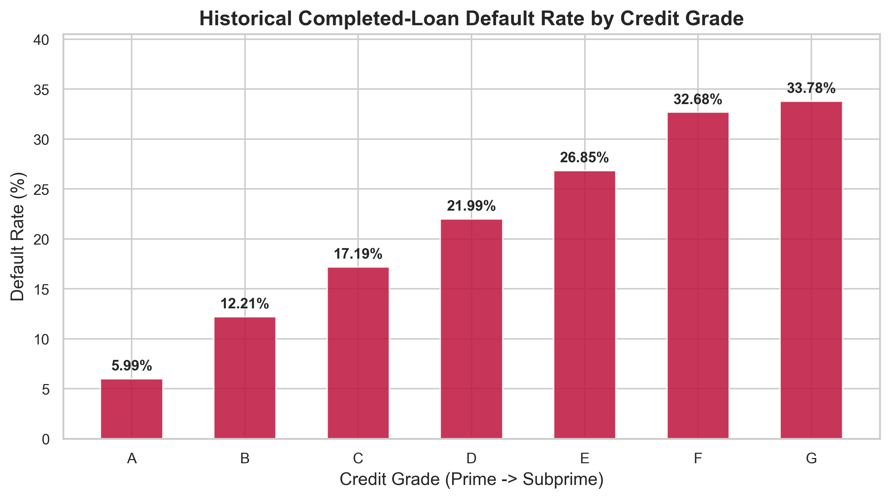 | **Default Rate by Credit Grade** | Monotonic Risk Progression: Grade A defaults at 5.99%, scaling to 33.78% for Grade G. |
| 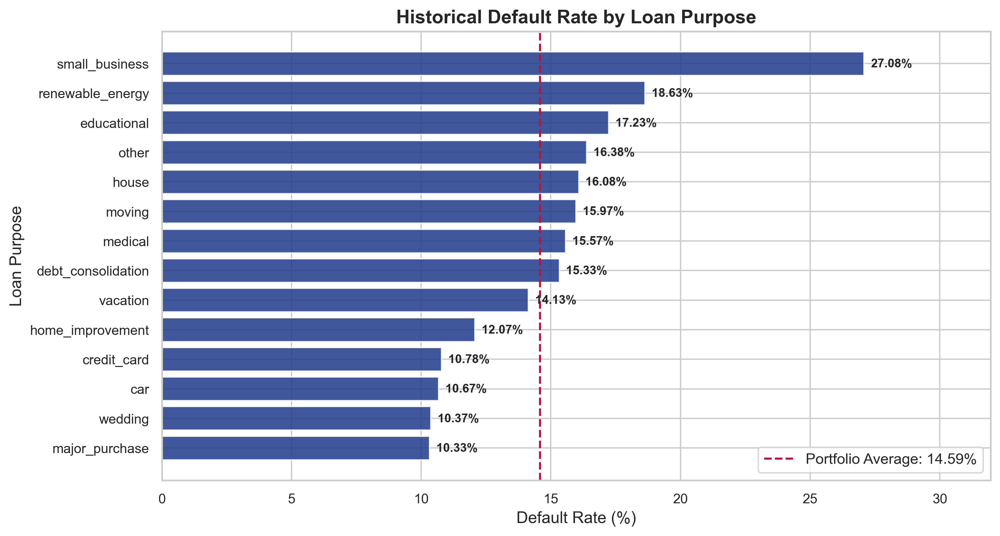 | **Default Rate by Purpose** | Small Business loans carry the highest default risk (27.08%), whereas Major Purchase (10.33%) and Car loans (10.67%) perform best. |
| 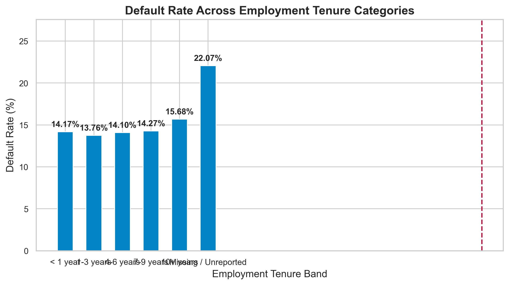 | **Default Rate by Tenure** | 10+ year employees default at 15.37%, slightly higher than 1-3 year workers (13.88%), driven by higher requested loan sizes. |
| 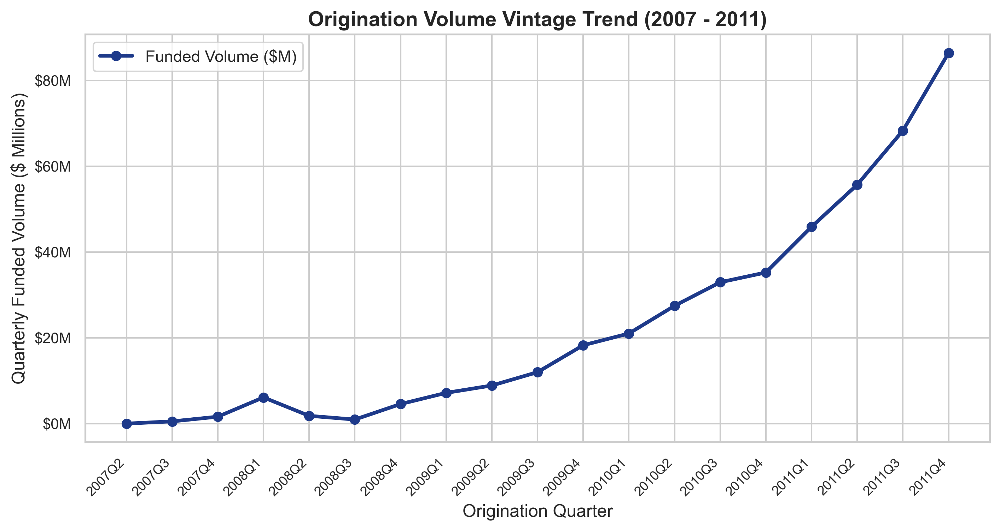 | **Quarterly Origination Trend** | Exponential origination growth from Q2 2007 ($1.2M) to Q4 2011 ($80.3M/quarter), demonstrating rapid P2P market adoption. |
| 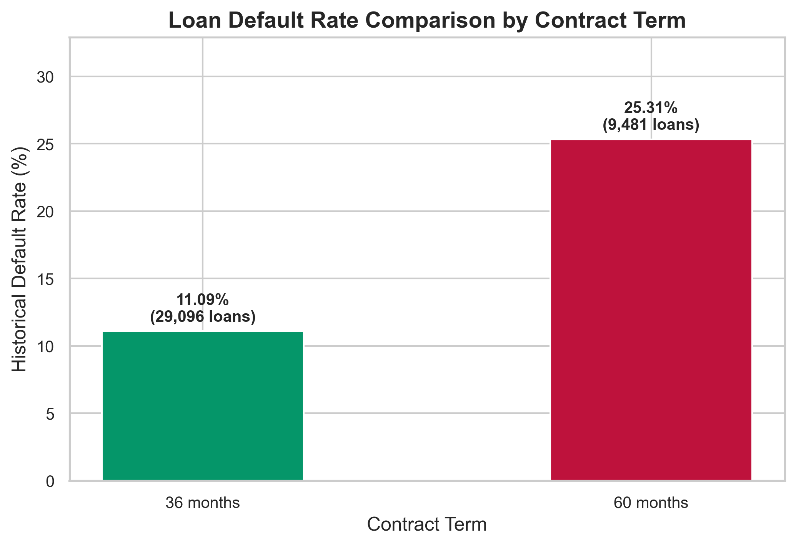 | **Performance by Term** | 60-month loans exhibit more than double the default rate (25.31%) of 36-month loans (11.09%). |
| 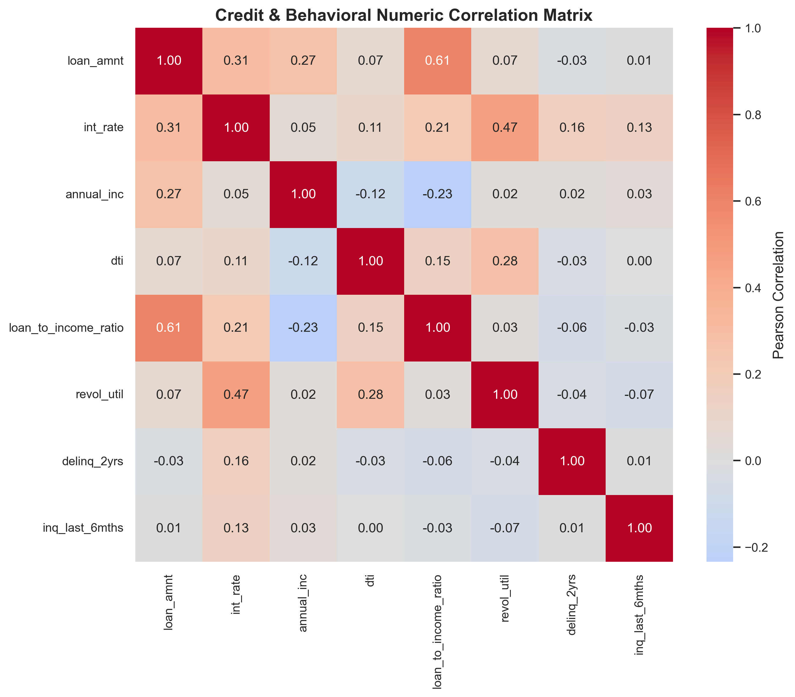 | **Risk Correlation Matrix** | Strong positive correlation between interest rate and default; moderate correlation between loan amount and annual income (r = 0.27). |
| 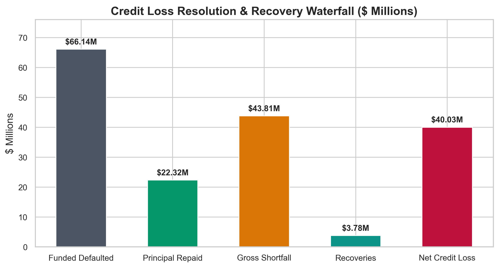 | **Credit Loss Waterfall** | $66.14M defaulted funded -> $22.32M repaid prior to default -> $43.81M gross shortfall -> $3.78M recovered -> $40.03M net loss (60.5% loss severity). |

---

## 6. Power BI Dashboard Architecture

* **[power_bi/dashboard_guide.md](power_bi/dashboard_guide.md):** Visual layout specifications, hex color palettes, and slicer cross-filtering instructions.
* **[power_bi/dax_measures.md](power_bi/dax_measures.md):** 20+ DAX measures with exact mathematical formulas.
* **[power_bi/data_model_schema.md](power_bi/data_model_schema.md):** Single-Table and Star-Schema dimensional data warehousing models.

---

## 7. Installation, Local Execution & Testing

### Installation
```bash
# Clone repository
git clone https://github.com/maddy1811/loan-portfolio-customer-behaviour-analysis.git
cd loan-portfolio-customer-behaviour-analysis

# Create virtual environment
python -m venv .venv
# Windows:
.venv\Scripts\Activate.ps1
# macOS/Linux:
source .venv/bin/activate

# Install dependencies
pip install -r requirements.txt
```

### Launch Interactive Streamlit Dashboard
```bash
streamlit run app.py
```
Open your browser at **`http://localhost:8501`**.

### Execute Pipelines & Automated Tests
```bash
# Run data cleaning & feature engineering pipeline
python src/data_cleaning.py --input data/raw/loan.csv

# Run financial risk metrics calculation
python src/risk_metrics.py

# Generate all 15 high-res publication figures
python src/generate_visualizations.py

# Run Pytest validation suite
pytest tests/test_portfolio_analysis.py -v
```

### Automated Unit Test Results:
```text
tests/test_portfolio_analysis.py::TestDataIntegrity::test_row_count_and_keys PASSED [  9%]
tests/test_portfolio_analysis.py::TestDataIntegrity::test_status_distribution PASSED [ 18%]
tests/test_portfolio_analysis.py::TestDataIntegrity::test_no_nulls_in_critical_metrics PASSED [ 27%]
tests/test_portfolio_analysis.py::TestFinancialMathAndAccounting::test_cashflow_balance PASSED [ 36%]
tests/test_portfolio_analysis.py::TestFinancialMathAndAccounting::test_net_credit_loss_accounting PASSED [ 45%]
tests/test_portfolio_analysis.py::TestFinancialMathAndAccounting::test_investor_gain_loss PASSED [ 54%]
tests/test_portfolio_analysis.py::TestCreditRiskAndDefaultRules::test_default_flag_exclusion_of_current_loans PASSED [ 63%]
tests/test_portfolio_analysis.py::TestCreditRiskAndDefaultRules::test_historical_default_rate_calculation PASSED [ 72%]
tests/test_portfolio_analysis.py::TestCreditRiskAndDefaultRules::test_monotonic_credit_risk_by_grade PASSED [ 81%]
tests/test_portfolio_analysis.py::TestFeatureEngineeringIntegrity::test_loan_to_income_safety PASSED [ 90%]
tests/test_portfolio_analysis.py::TestFeatureEngineeringIntegrity::test_tenure_and_term_cleaning PASSED [100%]

============================= 11 passed in 1.40s ==============================
```

---

## 8. Dataset Licensing & Safe Redistribution Notice

* The LendingClub loan dataset 2007–2011 is distributed under **Public Domain / CC0**.
* To adhere to open-source repository best practices and avoid storing large binary CSV files on GitHub, the 35 MB raw source file (`data/raw/loan.csv`) is preserved locally and excluded via `.gitignore`.
* A data dictionary (`data/raw/Data_Dictionary.xlsx`) and instructions to obtain the raw file from Kaggle or public mirrors are provided.
