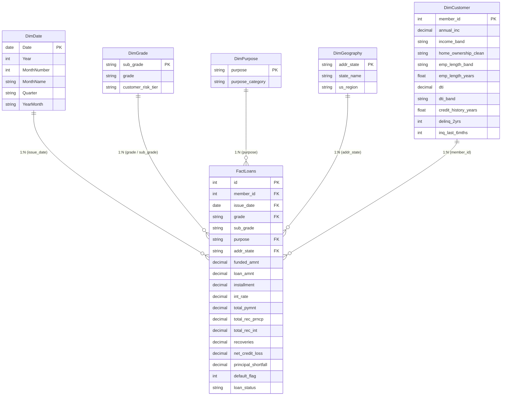

# Power BI Dimensional Data Model & Star Schema Architecture
## Loan Portfolio & Customer Behaviour Analytics

This document specifies both the **Single-Table Model** (immediate plug-and-play) and the **Star Schema Dimensional Model** (enterprise-grade data warehousing standard).

---

## Architecture 1: Single-Table Production Model (Recommended for Initial PBIX)

For swift validation and zero-loss DAX measure execution, `data/processed/loans_cleaned.csv` serves as the primary denormalized fact table **`Loans`**.

* **Row Count:** 39,717
* **Primary Key:** `id` (100% unique integer)
* **Secondary Key:** `member_id` (100% unique integer)
* **Temporal Key:** `issue_date` (`datetime64[ns]`)
* **Measures Storage:** Create an empty dedicated measures table named `_Measures` to house all portfolio and risk DAX formulas.

---

## Architecture 2: Enterprise Star Schema Specification

For institutional enterprise deployments (e.g. Fabric, Synapse, SQL Server, or Advanced Power BI Models), the denormalized dataset is decoupled into a star schema:



---

## DAX Date Dimension Table Formula
In Power BI, create a dynamic calendar table linked to `Loans[issue_date]`:

```dax
DimDate = 
VAR MinDate = MIN(Loans[issue_date])
VAR MaxDate = MAX(Loans[issue_date])
RETURN
ADDCOLUMNS(
    CALENDAR(MinDate, MaxDate),
    "Year", YEAR([Date]),
    "Month Number", MONTH([Date]),
    "Month Name", FORMAT([Date], "MMMM"),
    "Month Short", FORMAT([Date], "MMM"),
    "Quarter", "Q" & FORMAT([Date], "Q"),
    "Year Quarter", FORMAT([Date], "YYYY") & "-Q" & FORMAT([Date], "Q"),
    "Year Month", FORMAT([Date], "YYYY-MM"),
    "Month Year Sort", YEAR([Date]) * 100 + MONTH([Date])
)
```

### Relationship Properties:
* **Cardinality:** One-to-Many (`1:*`) from `DimDate[Date]` to `Loans[issue_date]`.
* **Cross-Filter Direction:** Single (Dimension filters Fact).
* **Mark as Date Table:** Yes, select `DimDate[Date]` as the unique date identifier.
* **Sort By Column:** Sort `Month Name` by `Month Number`, and `Year Month` by `Month Year Sort`.
